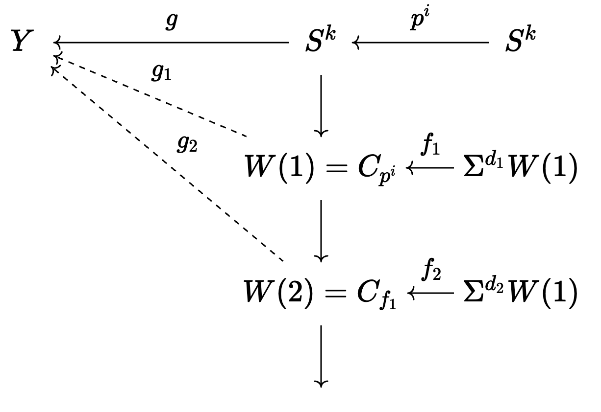
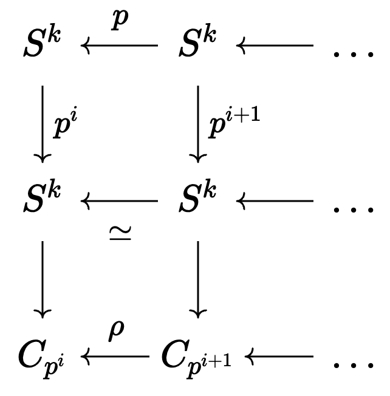
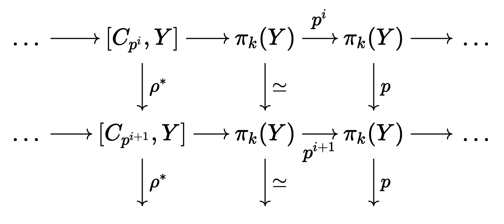

This chapter introduces us to the "chromatic picture" of homotopy groups/theory. As I said in the beginning of the Chapter 1 post, the graded ring $\pi_*^S$ is not well-described using generators and relations. (The graded ring structure coming from the composition product which works because we are working stably.) There's been many results on specific elements and families of elements, for example we know all elements are nilpotent and that that all stable homotopy groups of positive degree are finite, but the global structure is still a mystery. However, there are recognizable patterns within the infinite families, and using this structure, we can indeed understand the global picture. This will be put into more precise language, but I think this is the main idea. 

Besides looking at things from this new perspective, in this post we'll also develop our understanding of the aforementioned infinite families and how they come about. First we'll need some setup though.

## Setup

First, a definition.

::: {#def-cofib_seq}
A **cofiber sequence** is a sequence of spaces and maps of the form
$$
X \xrightarrow{f} Y \xrightarrow{i} C_f \xrightarrow{j} \Sigma X \xrightarrow{\Sigma f} \cdots
$$

where each space to the right of $Y$ is the mapping cone of the map preceeding the map to it, and each map to the right of $f$ is the canonical inclusion of a maps target into its mapping cone.
:::

Using this sequence, we obtain three fundamental long exact sequences in homotopy.

::: {#prp-cofib-pt2}
Let $X$ and $Y$ be path-connected CW complexes.

1. For any space $Z$, the cofiber sequence above induces a long exact sequence 
$$
[X,Z] \xleftarrow{f^*} [Y,Z] \xleftarrow{i^*} [C_f,Z] \xleftarrow{j^*} [\Sig X, Z] \xleftarrow{\Sig f} \cdots
$$

Everything to the left of $[C_f,Z]$ is naturally a group and so exactness means the usual thing. The terms to the right don't have an intrinsic group structure, but we can make exactness make sense since each of these sets contains a distinguished element (the trivial map). 
2. Let $E_*$ be a homology theory. Then there is a long exact sequence
$$
\cdots \xrightarrow{j_*} \overline{E}_m(X) \xrightarrow{f_*} \overline{E}_m(Y) \xrightarrow{i_*} \overline{E}_m(C_f) \xrightarrow{j_*} \overline{E}_{m-1}(\Sig X) \xrightarrow{f_*} \cdots
$$

3. Suppose $X$ and $Y$ are each $(k-1)$-connected and let $W$ be a finite complex which is a double suspension with top cell in dimension less than $2k-1$. Then there is a long exact sequence of abelian groups
$$
[W,X] \xrightarrow{f_*} [W,Y] \xrightarrow{i_*} [W,C_f] \xrightarrow{j_*} [W,\Sig X] \xrightarrow{\Sig f} \cdots
$$

This sequence will terminate at the point where the connectivity of the target exceeds the dimension of $W$.
:::

I'll note that the assumptions that we see in the above proposition are in place are due to the restrictions of the homotopy category of spaces. If we were working over spectra instead, we'd get long exact sequences of abelian groups that extend infinitely in both directions for (1) and (3).

From these induced long exact sequences (LES), we have the following corollary.

::: {#cor-cofib-type}
Suppose $X$ is a $p$-local finite CW complex of type $n$ for $n$ finite. Then, the cofiber of the $v_n$ self-map from the periodicity theorem has type $n+1$.
:::

::: {.proof}
We first assume $X$ has been sufficienty suspended to be the target of a $v_n$ map $f$, and we let $W$ be the cofiber. Using [@prp-cofib-pt2], we consider the following LES:
$$
\cdots \overset{j_*}{\longrightarrow} \overline{K(m)}_t(\Sigma^d X) \overset{f_*}{\longrightarrow} \overline{K(m)}_t(X) \overset{i_*}{\longrightarrow} \overline{K(m)}_t(W) \overset{j_*}{\longrightarrow} \overline{K(m)}_{t-1}(\Sigma^d X) \overset{f_*}{\longrightarrow} \cdots
$$

For $W$ to be type $n+1$, we must show that $K(m)_*(W)=0$ for $m<n+1$ and that $f$ induces an isomorphism on $K(n+1)_*(W)$.
If $m<n$, then since $X$ is type $n$, we know that $\overline{K(m)}_*(X)=0$ and thus also $\overline{K(m)}_*(\Sig^d X)=0$, forcing $\overline{K(m)}_*(W)=0$. For $m=n$, we know that $f_*$ is an isomorphism for every $t$ as $X$ is type $n$, and thus by exactness $\overline{K(n)}_*(W)=0$. When $m>n$, $f_*=0$ by definition, and we also have that $\overline{K(m)}+_*(X)\neq 0$ by the contrapositive of (5) of the properties of Morava K-theory. Now, if $f_*=0$, then by exactness, $j_*$ must be a surjection and $i_*$ an injection and so as a $K(m)_*$-module, $\overline{K(m)}_t(W)$ is an extension of $\overline{K(m)}_t(\Sig^{d+1} X)$ by $\overline{K(m)}_t(X)$. However as all $K(m)_*$-modules are free, this exact sequence splits and we have
$$
\overline{K(m)}_*(W)\cong \overline{K(m)}_*(\Sigma^{d+1} X) \oplus \overline{K(m)}_*(X)
$$

Therefore, $W$ has type $n+1$.

## Periodic maps: examples and general procedure
Now we will focus on periodic maps and how they can give us nontrivial elements of $\pi_*^S$. First we will look at some foundational examples and then move into the generalized framework.

:::{#exm-pdc-maps}
1. The degree map $p:S^1 \rightarrow S^1$ where $S^1\subset\CC$ given by $z \mapsto z^p$ is periodic in the sense that none of its iterates are nullhomotopic. All of its suspensions are essential as well.
2. Let $V(0)_k$ (aka mod $p$ Moore space) be the cofiber of the degree $p$ map on $S^k$. It has been shown by Adams and Toda that for sufficiently large $k$, there is a periodic map
$$
\Sigma^q V(0)_k \xrightarrow{\alpha} V(0)_k
$$

where $q=8$ for $p=2$ and $q=2p-2$ for $p$ odd. In the context of the periodicity theorem, $n=1$. The induced map on $K(1)_*(V(0)_k)$ is multiplication by $v_1$ for $p$ odd and $v_1^4$ for $p=2$. The $p=2$ case is interesting and what's even more interesting is that there is no self-map inducing multiplication by a smaller power of $v_1$ (for reasons which I don't completely understand at the moment).
3. Suppose $p\geq 5$ and take the cofiber of the map $\alpha$ above and denote it by $V(1)_k$. It has been shown that for $k$ sufficiently large, there is a periodic map
$$
\Sigma^{2p^2-2} V(1)_k \xrightarrow{\beta} V(1)_k
$$
inducing multiplication by $v_2$ in $K(2)$-theory.
4. For $p\geq 7$, denote by $V(2)_k$ the cofiber of the map $\beta$ above. There is a periodic map
$$
\Sigma^{2p^3-2} V(2)_k \xrightarrow{\gamma} V(2)_k
$$

As one can guess, this induces multplication by $v_2$ in $K(2)$-theory. Denote its cofiber by $V(3)_k$. 
:::

All of these periodic maps in the examples above give rise to infinite families of elements in $\pi_*^S$ as follows. 

For (1) this is easy as the degree $p$ map iterated $k$ times gives us the degree $p^k$ map, which is nontrivial for every $k$. 

For (2), we form the composite using the map $\alpha$:
$$
S^{k+qt} \xrightarrow{i_1} \Sig^{qt} V(0)_k \xrightarrow{\alpha^t} V(0)_k \xrightarrow{j_1} S^{k+1}
$$

Here the maps $i_1:S^k \rightarrow V(0)_k$ and $j_1:V(0)_k \rightarrow S^{k+1}$ are coming from the cofiber sequence given by the map $p:S^k\rightarrow S^k$. These are essentially the inclusion of the bottom cell and the contraction of everythin but the top cell, respectively. We use the same notation for a map and its suspensions. These maps are indeed essential for all $t>0$ and give an element in $\pi_{qt-1}^S$ denoted  by $\alpha_t$ for $p$ odd and $\alpha_{4t}$ for $p=2$. 
For (3) we let $i_2:V(0)_k \rightarrow V(1)_k$ and $j_2:V(1)_k \rightarrow \Sigma^{q+1}V(0)_k$ denote the maps in the cofiber sequence associated with $\alpha$. 
$$
\cdots \xrightarrow{j_2} \Sigma^q V(0)_k \xrightarrow{\alpha} V(0)_k \xrightarrow{i_2} V(1)_k \xrightarrow{j_2} \Sigma^{q+1} \Sigma^{q+1} V(0)_k \cdots
$$

In a similar way to the last example, if $p\geq 5$, we can use $\beta$ of above in the composite
$$
S^{k+(2p^2-2)t} \xrightarrow{i_2 i_1} \Sigma^{(2p^2-2)t} V(1)_k \xrightarrow{\beta^t} V(1)_k \xrightarrow{j_1 j_2} S^{2k+2p}
$$

which is denoted by $\beta_t\in \pi^S_{(2p^2-2)t-2p}$. These are essential for all $t>0$. If the composition above doesn't seem right, expand it out using the definitions and associated cofiber sequences and it will work out.

We use an analogous procedure for $\gamma$ and for $p \geq 7$ we obtain a composition
$$
S^{k+(2p^3-2)t} \rightarrow \Sigma^{(2p^3-2)t} V(2)_k \xrightarrow{\gamma^t} V(2)_k \rightarrow S^{k+p+2}
$$

In each of these examples, we have a periodic self-map of a finite CW complex, and this leads to an infinite family of elements in $\pi_*^S$. Specifically, our complex $X$ has bottom cell in dimension $k$, and top cell in dimension $k+e$ and we have some periodic map $f:\Sigma^{d} X \rightarrow X$. Then using $f^t$, we formed the composite
$$
S^{k+td} \xrightarrow{i} \Sigma^{td} X \xrightarrow{f^t} X \xrightarrow{j} S^{k+e}
$$ {#eq-composite}

thus giving us an element in $\pi^S_{td-e}$. One thing that's important to note is that the nontriviality of the obtained elements of $\pi_*^S$ does not follow the nontriviality of $f^t$. For instance, in each of the concrete cases above, a different argument is required. Despite this, there is still a way to generalize this procedure if the composite is nullhomotopic @eq-composite. Essentially, we can utilize the CW structure of $X$ to obtain an element of $\pi^S_{td-\epsilon}$, where $-e\leq \epsilon\leq e$. In general there is quite a bit of indeterminacy involved in this procedure, as it relies on choosing specific nullhomotopies of the above composition to extend maps. In the cases of $\alpha$, $\beta$, and $\gamma$ that we saw, however, there was no indeterminacy.

What's interesting about this procedure is that we have a new way of organizing elements in the homotopy groups of spheres. In this new light we'd like to see which elements do or do not fit into this framework. I'd like to see how we can interpret the Hopf elements $\eta$, $\sigma$, and $\nu$ as being apart of one of these families, which I imagine they do. 

## The chromatic filtration

Now it's time to try and clear up what is meant by organizing the homotopy groups of a finite complex via these infinite families. First, let's suppose that our CW complex $Y$ is $p$-local and that we have some element $y\in\pi_k(Y)$ that is represented by a map $g:S^k\rightarrow Y$. If all suspensions of $y$ have infinite order, then it would yield a nontrivial element in the rational stable homotopy group $\pi_k^S(Y)\otimes \QQ$. This is not too difficult to compute, since $\pi^S_*$ is a generalized homology theory and tensoring with $\QQ$ effectively just turns it into ordinary reduced rational homology. This is because generalized homology theories that equivalent when evaluated on a point are equivalent as functors.

Now, if some suspension of $y$ turns out to have order $p^i$ for some $i$, then this suspension will factor through the cofiber of the degree $p^i$ map on the corresponding suspension on the sphere $S^k$. We denote this cofiber by $W(1)$, so that our new map is of the form $g_1:W(1)\rightarrow Y$ and $g$ is identified with the composition of the inclusion of $S^{k+e}$ into $W(1)$ as a complex. **Note: in what follows we will be ignoring suspensions and everything is assumed to be taking place in the stable range.**

The complex $W(1)$ has type 1, since it is the cofiber of a self-map of a type 0 complex, $S^k$. (To see why $S^k$ has type 0, note that $\overline{K(0)}_*(S^k)\cong \overline{H}_*(S^k;\QQ) \neq 0$) the periodicity theorem guarantees the existence of a periodic self-map
$$
f_1:\Sigma^{d_1} W(1) \rightarrow W(1)
$$

inducing a $K(1)$-equivalence. We can now ask if composing $g_1$ with $f_1^t$ for some $t$ results in a nullhomotopic map. If the answer is no, and all composites $g_1f_1^t$ are stably essential, then $g_1$ will have a nontrivial image in the direct limit obtained by taking homotopy classes of maps from the inverse system
$$
W(1)\xleftarrow{f_1} \Sigma^{d_1} \xleftarrow{f_1} \Sigma^{2d_1} \xleftarrow{f_1} \Sigma^{3d_1} \cdots
$$

giving a direct system of groups
$$
[W(1),Y]^S_*\xrightarrow{f^*_1} [\Sigma^{d_1}W(1),Y]^S_*\xrightarrow{f^*_1} [\Sigma^{2d_1}W(1),Y]^S_*\xrightarrow{f^*_1} \cdots
$$

We will denote this direct limit by $v_1^{-1}[W(1),Y]_*^S$. This notion makes sense, since we are assuming that no composition of $g_1$ with any power of $f_1$ will result in a nullhomotopic element of $\pi_k^S(Y)$. Comparing this to the prior case and consider the analogously constructed group $p^{-1}[S^k,Y]_*^S$, this direct limit group is telling us about the $v_1$-periodic behavior of $\pi_k^S(Y)$ coming from $p^i$-torsion. Before, the $p$-periodic behavior showed up in the group $\overline{H}_*(Y;\QQ)$, which we can rewrite as $p^{-1}[S^k,Y]_*^S$. Looking at this notation for a second makes sense, as $Y$ is $p$-local so if we "invert" $p$, this will give us the rational behavior. 

If it turns out that $g_1f_1^{i_1}$ is stably nullhomotopic, then let $W(2)$ denote the cofiber of the map $f_1^{i_1}$ and let $g_2$ be the extension of $g_1$ over $W(2)$. It's clear that $W(2)$ has type 2 and so admits a periodic self-map
$$
f_2:\Sigma^{d_2} W(2)\rightarrow W(2)
$$

which is detected by $K(2)_*$. We are then led to consider $v_2^{-1}[W(2),Y]_*^S$ analogously. We may summarize the procedure in the following diagram:
{width="70%" fig-align="center"}
At the $n^{\text{th}}$ stage, we have an extension $g_n$ of the original map $g$ to the complex $W(n)$ of type $n$ equipped with a periodic self-map $f_n$. If $g_n$ is not stably annihilated by an iterate of $f_n$, then the process stops and $g_n$ has nontrivial image in $v_n^{-1}[W(n),Y]_*^S$. If g_n is stably annihilated by some iterate of $f_n$, then we move to the $(n+1)^{\text{th}}$ stage.

We make the folowing natural definition:

::: {#def-vn-torsion}
If an element $y\in\pi_*^S(Y)$ extends to a complex $W(n)$ of type $n$, then $y$ is **$v_{n-1}$-torsion**. If, in addition $y$ does not extend to a complex of type $n+1$, it is **$v_n$-periodic**. The chromatic filtration of $\pi_*^S(Y)$ is a decreasing family of subgroups consisting of $v_n$-torsion elements for various $n\geq 0$.
:::

I'll note that the procedure used above is different than what was used with the $\a_t$,$\beta_t$, and $\gamma_t$ families earlier. For example, if $p$ is odd and we take the map $\alpha_1 \in \pi_{2p-3}^S$ represented by the map $\alpha_1:S^{m+2p-3}\rightarrow S^m$, then $\alpha_1$ has order $p$, due to the construction from earlier. Thus, this map will extend to a map $\widetilde{\alpha_1}:V(0)_{m+2p-3}\rightarrow S^m$. It turns out that no iterate of $\alpha$ composed with $\alpha_1$ is nullhomotopic, meaning that $\alpha_1$ is $v_1$-periodic by the definition that was just made. The composite 
$$
S^{m+qi+q-1}\rightarrow V(0)_{m+qi+q-1}\xrightarrow{\alpha^i} V(0)_{m+q-1}\xrightarrow{\widetilde{\alpha_1}}S^m
$$
is the map $\alpha_{i+1}$ of the earlier construction. Note that in this formulation, we didn't need to use the pinch map $j:V(0)_m \rightarrow S^{m+1}$.
In general, given a $v_n$-periodic element $g :S^k \rightarrow Y$ and its extension $g_n:W(n) \rightarrow Y$, it may be the case that the composite
$$
S^K\xrightarrow{e}\Sigma^{d_n i}W(n)\xrightarrow{f^i_n} W(n)\xrightarrow{g_n} Y
$$

is essential ($e$ is inclusion map of bottom cell), even though we know $g_nf^i_n$ is. If it's nullhomotopic, then $g_nf_n^i$ will extend to a map from the cofiber of $e$, $C_e$. The extension may or may not be trivial on the bottom cell of $C_e$, but even so it must be nontrivial on one of the $2^n$ cells of $W(n)$, because if not then it would be nullhomotopic which would contradict our assumption. We can test this new bottom cell (i.e. of $C_e$) and consider the inclusion map of that cell and rinse and repeat until we get an essential composition from a sphere to $Y$. Thus, for any $i$, we can get a nontrivial element of $\pi_*^S(Y)$. We make the following definition:

:::{#def-pdc-family}
Given a $v_n$-periodic element $y\in\pi_*^S(Y)$, the elements described above for various $i>0$ constitute the **$v_n$-periodic family associated with $y$**.
:::

***Remark*** Let's return to the $v_1$ situation and the group $v_1^{-1}[W(1),Y]_*^S$. This is specifically looking at $v_1$-periodic behavior of $p^i$-torsion in $\pi_*(Y)$, which is great, but it would be nice to examine $v_1$-periodic behavior independently of the exponent of $p$, as this will give us the complete picture of $v_1$-periodicity in $\pi_k^S(Y)$. What we really need then, is a way to compatibly tie together all the $v_1^{-1}[C_{p^i},Y]_*^S$ for all $i$ in a way that yields a direct system that we can take the direct limit of.

We start with an inverse system of cofiber sequences:

{width="75%" fig-align="center"}

which induces a direct system of long exact sequences
{width="70%" fig-align="center"}
whose limit is a long exact sequence of the form 
$$
\cdots\rightarrow \pi_k(Y) \rightarrow p^{-1}\pi_k(Y) \rightarrow \pi_k(Y)/(p^{\infty}) \rightarrow \cdots
$$

where
$$
\pi_k(Y)/(p^{\infty}) = \varinjlim[\Sigma^{-1}C_{p^i},Y]
$$

The terms $[\Sigma^{-1} C_{p^i},Y]$ are coming from extending the cofiber sequences to the left, which is allowed in the stable range and can be performed unambiguously. We can interpret the odd-looking group $\pi_k(Y)/(p^{\infty})$ as capturing all of the $p$-torsion behavior, regardless of the exponent of $p$ required to kill a given element. 

Now, using some properties of $v_1$ maps on the Moore spaces $C_{p^i}$, we can indeed define the groups $v_1^{-1}[C_{p^i},Y]_*^S$ compatibly for various $i$. Thus, we may define $v_1^{-1}\pi_k/(p^\infty)$ as the limit of these groups.