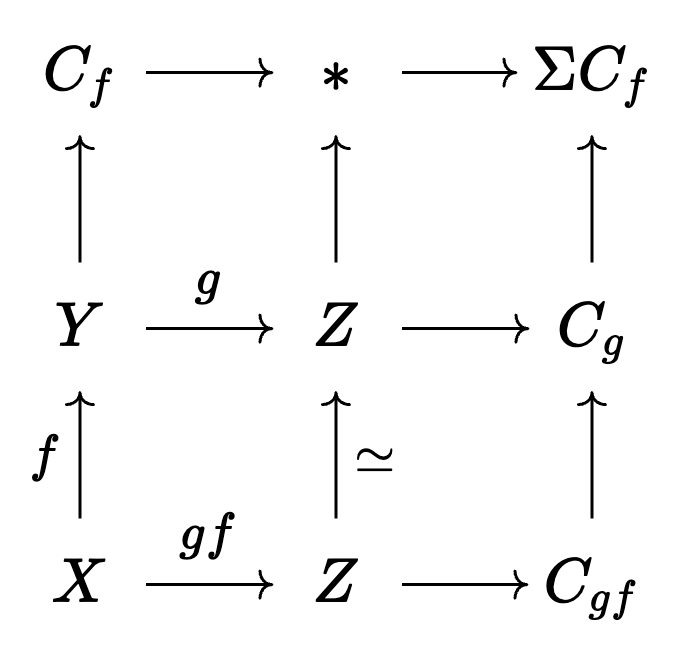
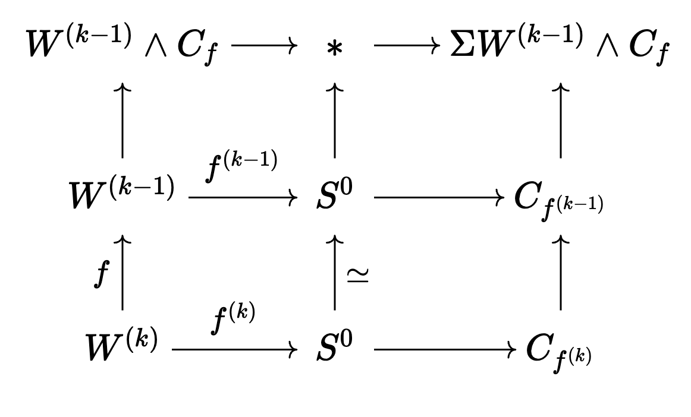

# The Spanier-Whitehead Dual

There is one last ingredient we need to prove the corollary in part 1 and thus the TST. It is called the **Spanier-Whitehead dual** and is analogous to the linear dual of a finite dimensional vector space. Its fundamental properties are captured in the following theorem.

:::{#thm-SpanWhite.dual}

Let $X$ be a finite spectrum. Then, we may associate to $X$ a homotopically unique finite spectrum $DX$ called the Spanier-Whitehead dual with the following properites:

1. For any spectrum $Y$, there is a natural isomorphism $[X,Y]_*\cong \pi_*(DX\wedge Y)$. By natural I mean this isomorphism is natural in $X$ and $Y$. Under this correspondence, we say a map $\Sigma^n X\rightarrow Y$ is **adjoint** to the map $S^n\rightarrow DX\wedge Y$. If $X=S^0$, then it's clear that $S^0$ is self-dual. If $X=Y$, then the identity map is adjoint to a map $e:S^0\rightarrow DX\wedge X$. 

2. The above isomorphism is also reflected in Morava K-theory. Explicitly, for Morava K-theory

$$
\Hom_{K(n)_*}(K(n)_*(X),K(n)_*(Y))\cong K(n)_*(DX\wedge Y)
$$ 

This is due to the fact that $K(n)_*(X)$ is free as a module over $K(n)_*$. The Künneth isomorphism allows us to break down the right hand side into a tensor product over $K(n)_*$, with freeness guaranteeing no $\Tor$ terms, then we can use the tensor-hom adjunction and freeness again to guarantee no $Ext$ terms and the desired isomorphism will pop right out. 

If $X=Y$, then $K(n)_*(e)$ is nontrivial as long as $K(n)_*(X)$ is. 

3. $DDX\simeq X$ and $[X,Y]_*\cong [DY,DX]_*$

4. For any homology theory $E_*$, there is a natural isomorphism $E_k(X)\cong E^{-k}(DX)$.
This follows from the chain of equalities

$$
E_k(X)=\pi_k(E\wedge X)=[S^0,E\wedge X]_k\cong[DX,E]_{k}=E^{-k}(DX)
$$

it's required that $X$ is finite, or the equalities may not hold. 

5. The Spanier-Whitehead dual distributes over the smash product:

$$
D(X\wedge Y)\cong DX\wedge DY
$$

6. The functor $X\mapsto DX$ is contravariant.

:::

This does bear some resemblance to the linear dual of a finite dimensional vector space: 1. is analogous to $\Hom(V,W)\cong V^*\otimes W$ and 3. and 5. have their partner statements as well. 

Ravenel also notes there is a geometric interpretation for this dual: a finite spectrum $X$ corresponds to a finite CW complex, which is also denoted by $X$. For large enough $N$, we can embed $X$ into Euclidean space $\RR^N$, and thus $S^N$ by one-point compactification. The Spanier-Whitehead dual $DX$ is then some suspension of the suspension spectrum of the complement $S^N-X$.

For $X$ as above, let $W$ be the spectrum defined so that the composite

$$
W\xrightarrow{f} S^0\xrightarrow{e} DX\wedge X
$$

is a cofiber sequence, so that $C_f=DX\wedge X$. It's a fact that such a $W$ always exists in $\HoSp$ and that in our case $W$ is also finite.

:::{#lem-ob5}
With the above notation, there is a cofiber sequence

$$
C_{f^{(k)}}\rightarrow C_{f^{(k-1)}} \rightarrow \Sigma W^{(k-1)} \wedge C_f
$$

for each $k>1$.
:::

:::{.proof}
Standard lemma in homotopy theory says that for a cofiber sequence $X\xrightarrow{f} Y\xrightarrow{g} Z$, we can obtain the following diagram where all rows and columns are cofiber sequences.

{width="75%" fig-align="center"}

If we take $X=W^{(k)}$, $Y=W^{(k-1)}$, $Z=S^0$, and $g=f^{(k-1)}$, then we obtain the following diagram.

{width="75%" fig-align="center"}

(The $f$ in the left column is really $W^{(k-1)}\wedge f$). The cofiber sequence on the right is what we were looking for.
:::

# A couple of proofs

We now move on to the proof of the corollary of the nilpotence theorem and then to proof of the TST. Before I get into it, the proof of the corollary relies on methods that aren't introduced fully until chapter 7, so later in the proof I'll make a disclaimer where exactly these come in. I'll still try to give my interpretation of the general gist of what those results do and why we need them of course. 

To recall just exactly what we're trying to prove here: suppose $W,X$, and $Y$ are $p$-local finite spectra and $f:X\rightarrow Y$ is a map. We need to show that if $K(n)_*(W\wedge f)$ is trivial for all $n$, then $W\wedge f^{(k)}$ is nullhomotopic for some $k$ sufficiently large.

:::{.proof}
Let $R=DW\wedge W$ and $e:S^0\rightarrow R$ is adjoint to the identity map on $W$. We have that $R$ is a ring spectrum with multiplication given by

$$
R\wedge R=DW\wedge W\wedge DW\wedge W\xrightarrow{DW\wedge De\wedge W} DW\wedge S^0\wedge W=R
$$

since $D(e:S^0\rightarrow DW\wedge W)$ is the map $De:D(DW\wedge W)\rightarrow DS^0=W\wedge DW\rightarrow S^0$, and the smash product is commutative. Additionally, $e$ corresponds to the unit map of $R$ via its definition.

The map $f$ is adjoint to the map $\hat{f}:S^0\rightarrow DX\wedge Y$, so smashing with $W$, this means $W\wedge f$ is adjoint to the composite

$$
S^0\xrightarrow{\hat{f}} DX\wedge Y=S^0\wedge DX \wedge Y\xrightarrow{e\wedge DX\wedge Y} DW\wedge W\wedge DX\wedge Y=R\wedge DX\wedge Y
$$

The last term $R\wedge DX\wedge Y$ will be denoted by $F$ and the entire composite will be denoted by $g:S^0\rightarrow F$. By expanding the maps we can generalize this to see that $W\wedge f^{(i)}$ is adjoint to the composition

$$
S^0\xrightarrow{g^{(i)}} F^{(i)}=R^{(i)}\wedge DX^{(i)} \wedge Y^{(i)}\xrightarrow{m} R\wedge DX^{(i)} \wedge Y^{(i)}
$$

where the last map is induced by the multiplication map of $R$.

Now, if we can show that $MU\wedge g^{(i)}$ is nullhomotopic, then this will imply that $g^{(i)}$ (and $g$) is smash nilpotent by the nilpotence theorem. This will of course imply that the composite $m g^{(i)}$ will eventually nullhomotopic for high enough $i$ and thus its adjoint $W\wedge f^{(i)}$ will be nullhomotopic, proving the result. We can prove that $MU\wedge g^{(i)}$ is nullhomotopic by showing a certain spectra $MU\wedge T$ is contractible, where $T$ is essentially a localization of $g$, analogous to the construction with modules. In this context this is called a *mapping telescope*. Explicitly, let $T_i=R\wedge DX^{(i)} \wedge Y^{(i)}$ and define 

$$
T=\varinjlim(S^0\xrightarrow{g} T_1\xrightarrow{T_1\wedge \hat{f}} T_2\xrightarrow{T_2\wedge\hat{f}} \cdots)
$$

(it's not super obvious that this is effectively localizing the map $g$, but Ravenel has written it this way for brevity and if you expand and use the defintion of $\hat{f}$ it's easy to see). Using the "localiziation" perspective, $MU\wedge T$ being contractible necessarily means that $MU\wedge g$ (and thus $MU\wedge g^{(i)}$) is nullhomotopic. 

By hypothesis, we have that $K(n)_*(W\wedge f)=0$ for all $n$. As $g$ is the adjoint of this map and we know that Morava K-theory plays nicely with duality, we also have $K(n)_*(g)=0$ for all $n$. By definition of $T$, this means that $K(n)_*(T)=\pi_*(K(n)\wedge T)=0$ for all $n$. But this means $K(n)\wedge T$ is contractible. TL;DR: we have to show $MU\wedge T$ is contractible assuming that $K(n)\wedge T$ is contractible for all $n$. 

This is where we use stuff from chapter 7. Since we're working $p$-locally, we can focus on $BP\wedge T$, as $MU_{(p)}$ is an infinite wedge of suspensions of $BP$. The key notion from chapter 7 that is relevant here is Bousfield equivalence classes. Two spectra $E$ and $F$ are Bousfield equivalent if for any spectrum $X$, $E\wedge X$ is contractible if and only if $F\wedge X$ as well. This can be written as $\langle E \rangle =\langle F \rangle$. Using this notation, the most recent claim can be rewritten as $\langle MU_{(p)} \rangle=\langle BP \rangle$. A key theorem of chapter 7 says that the class $\langle BP \rangle$ decomposes into smaller pieces built by the classes $\langle K(n) \rangle$ and $\langle P(n) \rangle$ where $P(n)$ is another important spectrum. We already have that $K(n)\wedge T\simeq 0$ for all $n$ so we just need to take care of $P(n)$ by showing $P(m)\wedge T$ is contractible for large enough $m$.

The spectra $X,Y,$ and $W$ are all finite, so by the properties of $K(n)$, we can break up $K(m)_*(W\wedge f)$ into $K(m)_*\otimes H_*(W\wedge f)$. This is really shorthand for $id_{K(m)_*}\otimes H_*(W\wedge f)$, consistent with Ravenel's notation throughout the book. It's also important to note that this was stated earlier in terms of spaces/spectra, but it's true for maps as well, not exactly sure where this comes from though. It turns out we can do the same thing with $P(m)$ so that $P(m)_*(W\wedge f)=P(m)_*\otimes H_*(W\wedge f)$ (also, both these tensor products occur over $\FF_p$). The coefficient ring $K(n)_*$ is a graded field, as well as a non-zero vector space over $\FF_p$, and since $K(m)_*(W\wedge f)=K(m)_*\otimes H_*(W\wedge f)=0$ it must be that $H_*(W\wedge f)$ is the zero map. This implies that $P(m)_*(W\wedge f)=0$, and since this is the foundation for the telescope $T$, it follows that $P(m)\wedge T$ is contractible, and we are done.
:::

This proof was pretty technical in my opinion and it took me a second to figure out. I had to look up things and consult other sources so things might not be 100% accurate but I think I got the main argument/idea down. I'll now go through the proof of the TST, which I'll restate. 

Let $\FH_{(p)}$ be the category of $p$-local finite spectra. Recall that a full subcategory $\mathbf{C}$ is **thick** if for any cofiber sequence $X\xrightarrow{f} Y\rightarrow C_f$ in $\mathbf{C}$, if two of the three spectra are in $\mathbf{C}$, then so is the third. Additionally, if $X\vee Y$ is in $\mathbf{C}$, then $X$ and $Y$ are both in $\mathbf{C}$

:::{#thm-TST.spectra}
**(Thick Subcategory Theorem)**

If $\mathbf{C}$ is a thick subcategory of $\FH_{(p)}$, then $\mathbf{C}$ is either trivial, all of $\FH_{(p)}$, or consists of all $p$-local finite spectra $X$ with $v_{n-1}^{-1}MU_*(X)=0$ (this is equivalent to the condition that $v_{n-1}^{-1}BP_*(X)=0$ and $K(n-1)_*(X)=0$ for reasons in chapter 7). We will denote the latter category by $\mathbf{F}_{p,n}$.
:::

:::{.proof}
Suppose $\mathbf{C}\subset \FH_{(p)}$ is thick and let $X\in \mathbf{C}$. Let $n$ be the smallest integer such that $v_n^{-1}MU_*(X)$ is nonzero, so that $X\in \mathbf{F}_{p,n}$. Such an $n$ must exist or $\mathbf{C}$ would be trivial. Thus $\mathbf{C}\subset\mathbf{F}_{p,n}$. We must show the reverse inclusion. 

Let $Y\in \mathbf{F}_{p,n}$ (i.e. $p$-local finite spectra of type $n$). We want to show $Y\in \mathbf{C}$. Since $X\in \mathbf{C}$ and $\mathbf{C}$ is thick, for any finite spectrum $F$, the smash product $X\wedge F\in \mathbf{C}$. This comes down to the fact that $F$ is the suspension spectrum of a finite CW complex, and we can obtain $X\wedge F$ from a finite series of cofiber sequences that correspond to attaching the cells of $F$. Let $F=DX\wedge Y$, and $X\wedge DX\wedge Y\in \mathbf{C}$, which using the notation of @lem-ob5, means $C_f\wedge Y\in \mathbf{C}$. @lem-ob5 tells us that we have a cofiber sequence $C_{f^{(2)}}\rightarrow C_{f}\rightarrow \Sigma W \wedge C_f$, and smashing with $Y$ yields the sequence

$$
C_{f^{(2)}}\wedge Y \rightarrow C_{f}\wedge Y \rightarrow \Sigma W \wedge C_f\wedge Y
$$

Now the middle term is in $\mathbf{C}$, and so is the last term since $\Sigma W$ is a finite spectrum. By thickness, the first term is in $\mathbf{C}$ as well. Inducting upwards, we have that $C_{f^{(k)}}\wedge Y\in \mathbf{C}$ for all $k$. If we can show that $f^{(k)}\wedge Y$ is nullhomotpic for high enough $k$, then the cofiber $C_{f^{(k)}}\wedge Y$ will degenerate into  a wedge sum, and this will give that $Y\in \mathbf{C}$.

By hypothesis, $K(i)_*(X)$ is nontrivial when $i\geq n$, and by Spanier-Whitehead duality, this means that $K(i)_*(e)$ is nontrivial for $i\geq n$. Morava K-theory is a homology theory, so applying it to the cofiber sequence $W\xrightarrow{f} S^0 \xrightarrow{e} DX\wedge X$ yields an exact sequence

$$
K(i)_*(W)\xrightarrow{K(i)_*(f)} K(i)_*(S^0)=K(i)_*\xrightarrow{K(i)_*(e)} K(i)_*(DX\wedge X)
$$

but $\ker(K(i)_*(e))$ will be a proper graded $K(i)_*$-submodule of the coefficient ring, but this is exactly a proper homogeneous ideal, which must be trivial so $K(i)_*(e)$ is injective and $K(i)_*(f)$ is zero. From our assumptions, this is true when $i\geq n$. We also assumed that $Y\in \mathbf{F}_{p,n}$ so that $K(i)_*(Y)=0$ for $i<n$. Putting these together and using the Künneth isomorphism for Morava K-theory, we see that $K(i)_*(Y\wedge f)$ is trivial for all $i$. By the corollary to the nilpotence theorem, this means that $Y\wedge f^{(k)}$ is nullhomotopic for sufficiently large $k$. Now the smash product plays nice with cofiber sequences in $\HoSp$, so $Y\wedge C_{f^{(k)}}$ is the cofiber of $Y\wedge f^{(k)}$. Since this map is nullhomotopic, this cofiber degenerates to $Y\vee \left(\Sigma Y \wedge W^{(k)}\right)$. We've already shown that $Y\wedge C_{f^{(k)}}=Y\vee \left(\Sigma Y \wedge W^{(k)}\right)\in \mathbf{C}$, and by thickness it follows that $Y\in \mathbf{C}$.
:::

# Ending thoughts

With this, we've shown that the structure of the category of $p$-local finite spectra is stratified by type, and consequently by chromatic height. We have a nice nested sequence of thick subcategories

$$
\mathbf{FH}_{(p)} = \mathbf{F}_{p,0} \supset \mathbf{F}_{p,1} \supset \mathbf{F}_{p,2} \cdots \{\text{pt.}\}
$$

As we've already seen, this is reflected algebraically as well with $\mathbf{C \Gamma}_{(p)}$ due to how FGLs over $k$ (algebraic closure of $\FF_p$) are organized by height. There seems to be a very deep connection between the two but I'm not sure exactly how to formulate it. In the algebra, the thick subcategories are $\mathbf{C}_{p,n}$ which consist of $p$-local modules where $n$ is the smallest integer such that $v_n^{-1}M\neq 0$, which is to say that there is at least one element such that $v_n$ does not act nilpotently on. It's stated that the homology theories $v_n^{-1}MU_*$ and $K(n)_*$ are interchangeable here (I'm identifying $MU_*(X)$ with the module $M$ implicitly here), but I don't understand why. I get that both are focusing on chromatic height $n$ and above, but I feel like there's something deeper going on. Perhaps I need to understand where Morava K-theory comes from. Additionally, all of this seems to be easier to articulate in $BP$-theory, but to talk about $BP$-theory and $MU$-theory concurrently requires more category theory and algebra, so I'll probably save that for a little later.  

Anyway, the TST allows us to focus our line of reasoning on individual spectra: say we want to prove something about spectra with a certain property $A$. If we can show that the subcategory of spectra with property $A$ is thick, and we can produce a specific spectrum of type $n$ with this property, then it will automatically extend to all other spectra of type $n$. The organization of thick subcategories is what guarantees us this ability and is the exact line of reasoning that Ravenel uses to prove the periodicity theorem. 